# The Book

**A leather-bound, generative-art journal that records every part of handwriting — and turns it into the paint.**

  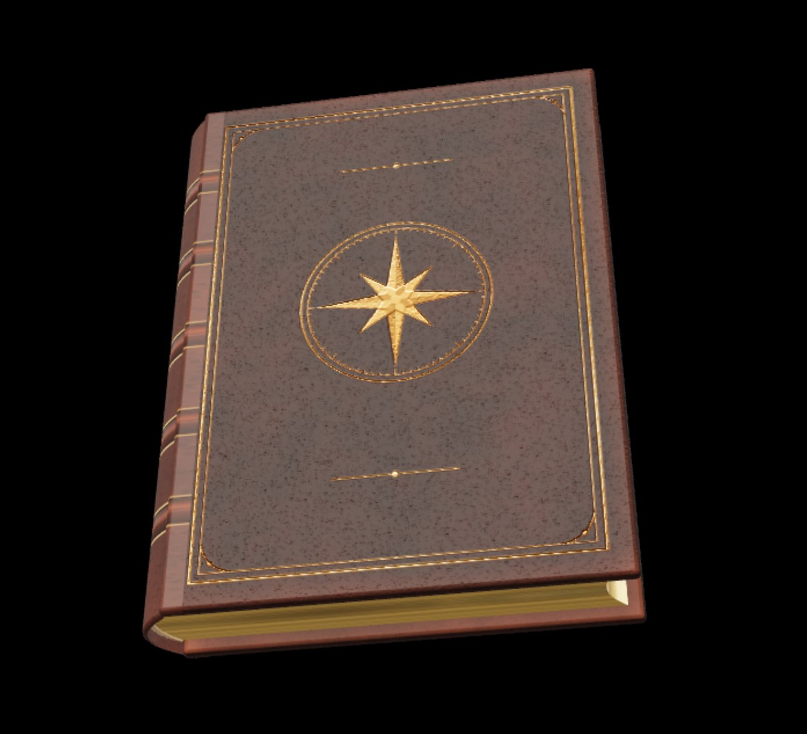

> This repo is a showcase only — screenshots and a write-up. The Book's source code is private.

---

## The idea

I wanted my handwriting to be **fully recorded and dissected** — not saved as a picture of ink, but captured as everything the pen actually did: how hard I pressed, how fast I moved, how far the pen leaned, when I paused, where the pen hovered in the air between letters, and the exact moment every point went down.

Then I wanted all of that to become **parameters for generative art**. The writing itself is the input. Pressure can drive a brush's size, speed can drive how fast sparks fly, a pause can be the moment the page goes dark. Every page is its own piece of art, built from the way it was written.

And I wanted it to live somewhere that feels real, so it's a **skeuomorphic journal**: a thick, vintage, leather-bound book floating in a dark void. It has gilt tooling on the cover, marbled endpapers, page edges you can see, and pages that turn and fall the way they lean. The pen presses grooves into the paper that catch the light when you zoom in. An eraser lifts the ink but leaves the grooves behind, the same as a real one. Turn a written page over and its back shows the ridges and the ink that bled through.

The point of all of it: **a journal that can visualize every part of writing.**

  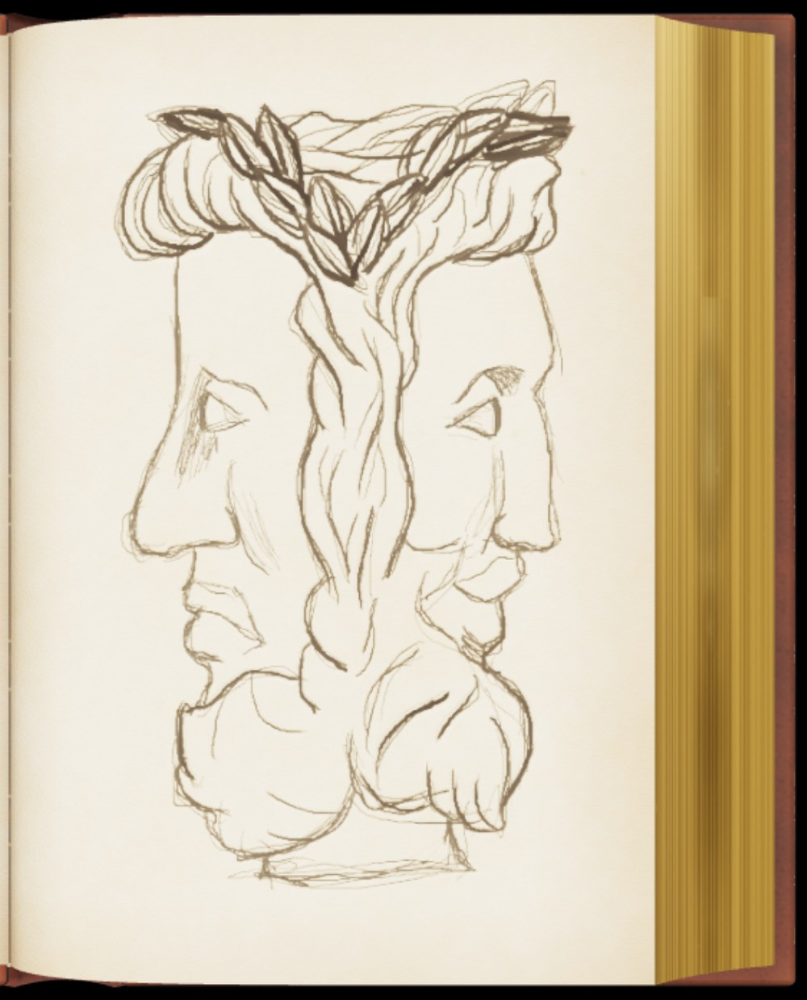

<i>Janus, drawn in The Book. Every line is a full recording, not just a picture.</i>

---

## How it works

I write on my XP-Pen tablet straight onto the right-hand page. While I write, the book records and displays:

- **Pressure**: exactly as the pen reports it, never smoothed or rescaled by how the ink looks
- **Speed**: how fast the nib is moving at every point
- **Tilt**: how far the pen leans
- **Time**: the real clock behind every point, so any page can replay itself exactly as it was written
- **Hovering**: the pen's path through the air between strokes
- **Pauses and breaks**: short waits, long waits, and when I walked away

Every page saves itself as I go, with its strokes, its labels, and its art layers all kept together.

---

## Seeing every part of the writing

### Layers

The open page can be shown in different **layers**:

- **As written**: plain ink
- **Pressure**: ink coloured from light cyan (soft) to red (hard)
- **Speed**: from slow amber to fast blue
- **Tilt**: from upright olive to leaning violet
- **Graphs**: small graphs drawn under each line of writing representing one or all measurements, lined up so a dip in the graph sits right under the letter that made it
- **Stroke ends / Ends joined**: each stroke cut down to just where it started and where it lifted
- **Negative**: dark page, light ink, which works with every layer

The same Janus drawing in three layers: pressure, speed, and stroke ends.

  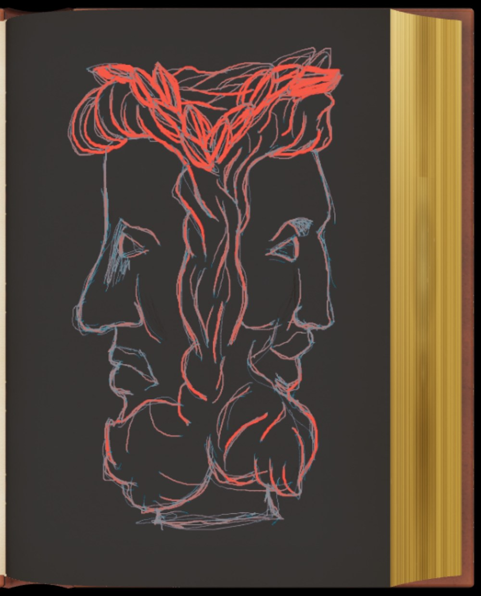
  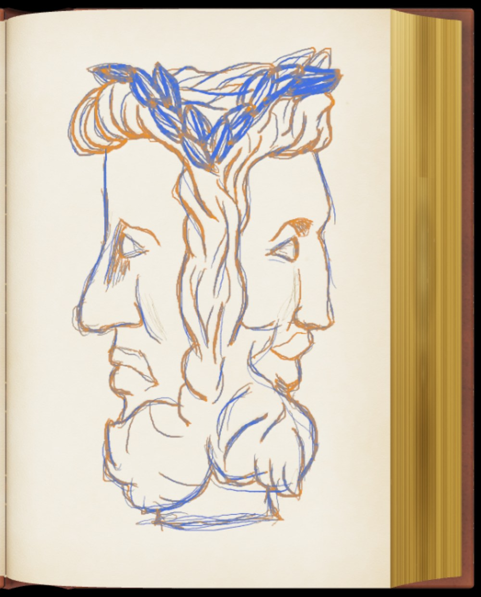
  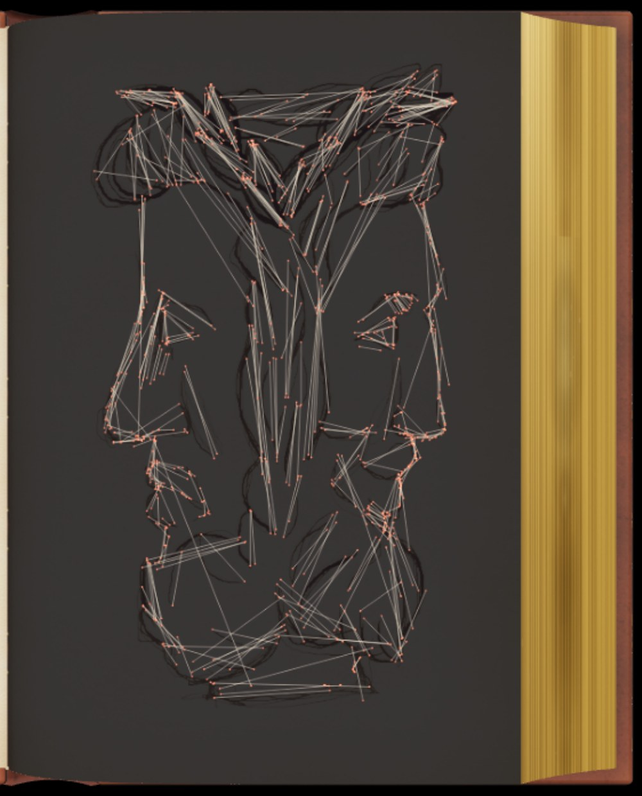

  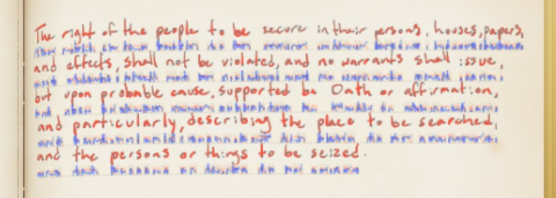

### The Measure tab

A workbench slides out from the right side of the book. The Measure tab shows the writing live as it happens: level bars, a rolling graph, and a **spectrum** that lays the pen's rhythm out the way a music equalizer shows frequencies. It also has graphs of the whole page in time, and of the whole page **on the clock**, where every row is the same number of real seconds, so a long pause takes up as much room as it actually took.

  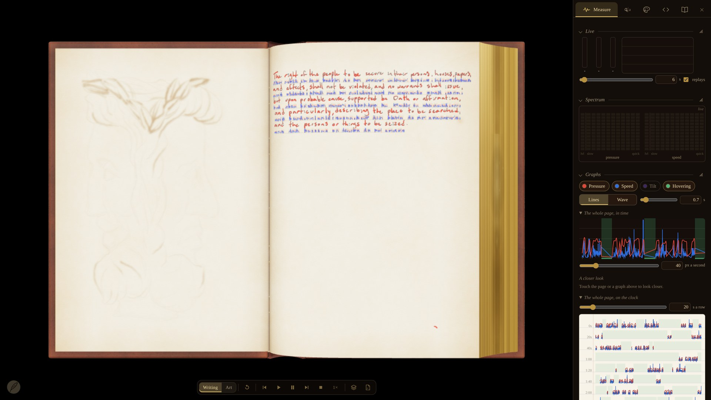

### 3D, in time

The page can lift off the paper into **3D**. Each stroke becomes a curve in space, and any of left-right, up-down, pressure, speed, tilt, or **time** can go on any axis. Put time across and the whole drawing unrolls in the order it was made, so you can see how Janus was built from the first stroke to the last, with pressure standing out as depth.

  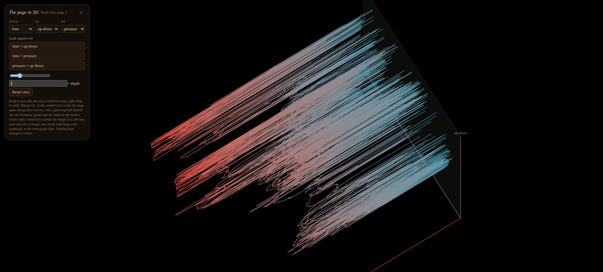

Looked at square-on as time against pressure, the drawing turns into a skyline of how hard I pressed from start to finish. The tall red towers near the end are the heavy final lines.

  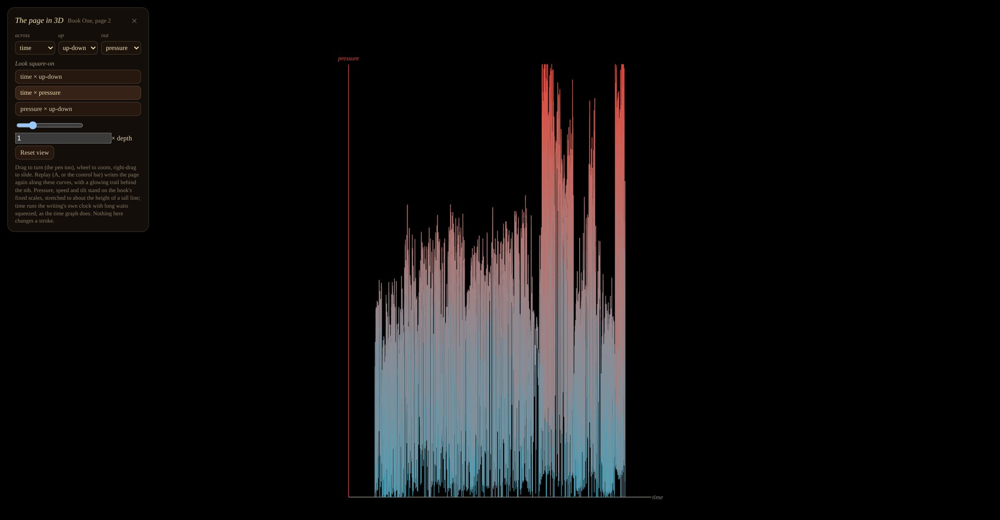

### The glyph view

Turn the 3D view so you're looking at left-right position against pressure, and every letter turns into its own rune-like glyph. **The same letter keeps the same glyph** no matter the size, speed, or pressure I wrote it with. This page is a piece of writing (4th Amendment) in that view:

  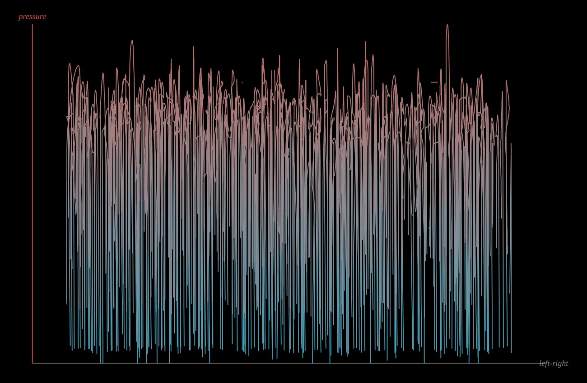

### Exports

Any page can be exported as SVG, PDF, or JPG, in any layer, with a key under each picture that says exactly what it shows. These are exports of the Fourth Amendment page:

  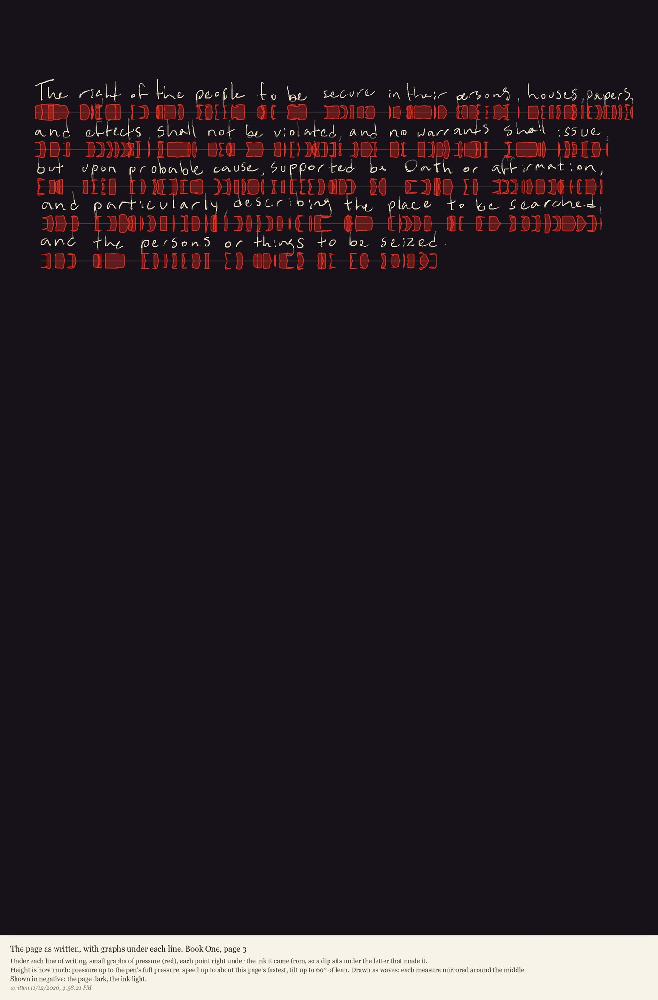

<i>The page as written, with mirrored wave graphs under every line.</i>

  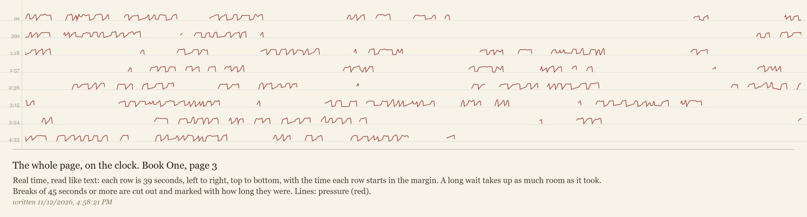

<i>The page on the clock: every row is the same number of real seconds, so pauses take up as much room as they really took.</i>

  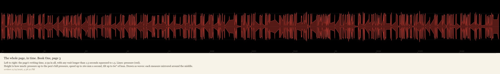

<i>The whole page in time, drawn like a sound wave.</i>

---

## Labeling: letter by letter, word by word

After I write, I tell the book what the writing **truly says**, right against the ink.

The book splits the page into lines and words. Then I go word by word: I type the word, and the book gives each letter its share of the ink, shown in its own colour. If a letter's ink is split wrong, I pick that letter and rub the pen over the ink that belongs to it. Words can be split, merged, cut apart, or moved to the next line.

Once a page is labeled, every measurement is tied to a real letter. From there the book can:
- show the labels on the page itself, with the typed word under the writing
- sort each line's graph by letter, so a dip lines up with the letter that made it
- stack **every copy of a letter I've ever written** on top of each other, with its size, speed, pressure, lean, and how far each copy strays from my usual shape
- keep track of my words across the whole book: how many, how many are different, and which ones I use most

The more I label, the better the book's first guess at my letters gets.

**Right now, labeling only works on words written inside The Book**, since it needs the full pen recording behind every stroke. Scanned or photographed handwriting can't be labeled yet.

  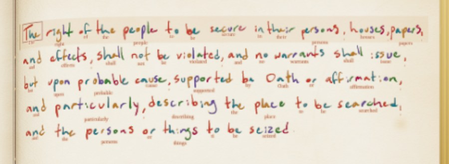

  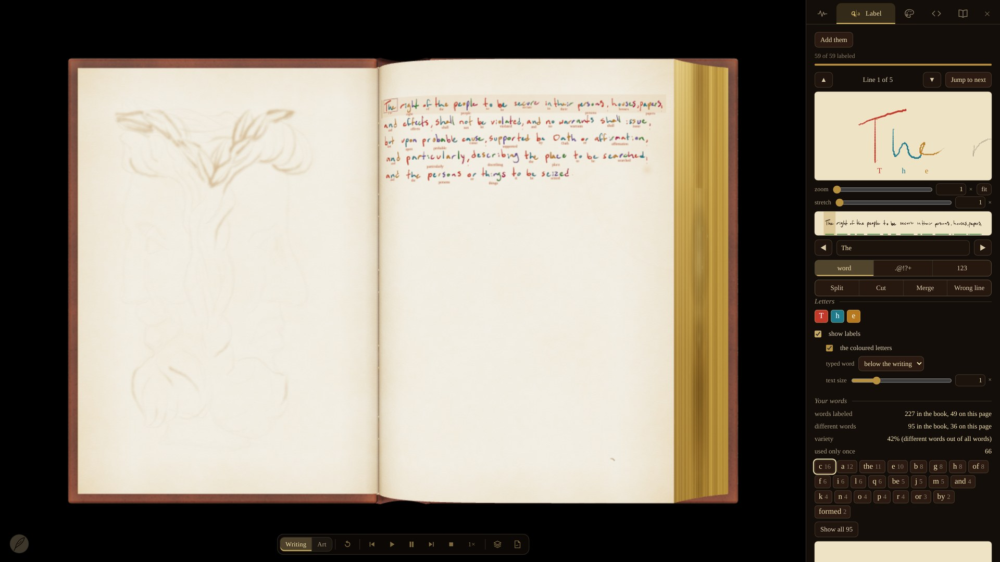

---

## Art: brushes and layers

Each page has its own art, built in **layers** like coats of paint. Each layer is one **brush** with its dials set.

Any dial can be wired to the writing itself, like pen pressure or writing speed, or to time, the page turning, a slow wobble, or a steady pulse. A page's art starts fresh every time I turn to it and replays on its own. It never changes the ink underneath.

Some of the brushes that come with the book:

- **Lightning**: the page goes dark and bolts run through the writing
- **Embers**: sparks lift off wherever I pressed hardest
- **Smoke**: the writing evaporates, piece by piece
- **Rings**: a portrait of how the page was written, using colored rings where the pen began a stroke
- **Replay**: the page writes itself again
- **Build your own**: put a brush together from parts (where it comes from, when, how it moves, how it looks, how long it lasts)

  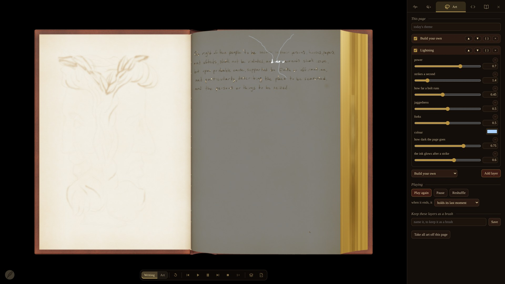

### Custom art brushes

This is the part I'm most excited about. The book has its own **brush workbench built in**, so new brushes can be written, run on the open page, and saved without ever leaving the book. Every dial a brush has turns into a slider in the workbench, and a mistake in a brush only switches that one layer off. It can't break the book. Every save keeps the version before it, so nothing gets lost to a bad edit.

A brush gets access to the full recording of the page: every point with its pressure, speed, tilt and timing, the labels, and even the page in 3D. That opens up a lot of possibilities:

- brushes that react **differently to each letter**, since the letters are labeled
- brushes driven by **rhythm**, using the spectrum of how my hand moves
- brushes that build **their own 3D picture** of the page
- a stack of layers saved as a **new brush** that any page can use
- one day, brushes other people can make and share

---

<i>Designed and directed by Jessie · Built on Windows with an XP-Pen tablet · Source private</i>

